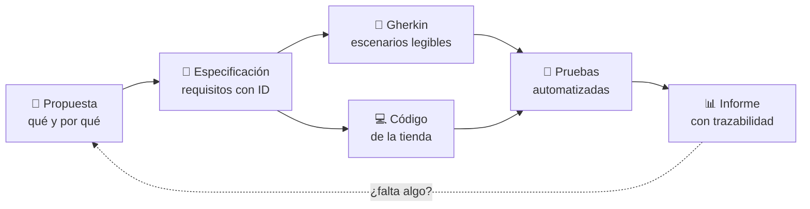
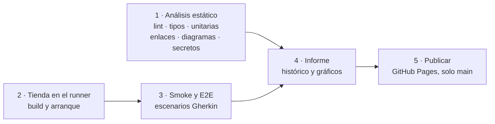
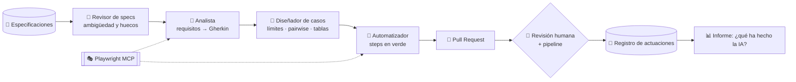

<p align="center">
  
</p>

<p align="center">
  <a href="https://github.com/tonyfht/qa-agentic-lab/actions/workflows/pipeline.yml"></a>
  <a href="https://tonyfht.github.io/qa-agentic-lab/"></a>
</p>

**QA Agentic Lab** es un laboratorio abierto para aprender **otra forma de hacer QA**: ni la tradicional, revisando a
mano al final, ni solo automatizar pruebas. Aquí la calidad se apoya en la IA en todo el ciclo de vida del software
(requisitos, pruebas, seguridad, cumplimiento e informe) y todo nace de una **especificación** que manda sobre el
código y sobre las pruebas.

Para enseñarlo hay una tienda online pequeña, **La Tienda en Casa**, construida a propósito para ser probada. Cada
cambio pasa por el mismo camino: especificación → código → escenarios en lenguaje natural (Gherkin) → pruebas →
informe. Puedes recorrerlo con la guía de abajo o ejecutarlo tú mismo.

> **Estado:** la tienda ya tiene catálogo con búsqueda, filtros y API (`QAL-002`). La hoja de ruta
> completa está en [`openspec/PROJECT.md`](openspec/PROJECT.md#hoja-de-ruta).

## Ruta de la visita

Sigue los pasos en orden. Cada uno dice qué abrir y qué deberías ver.

1. **La idea en un minuto.** Abre [`openspec/PROJECT.md`](openspec/PROJECT.md). Verás la visión, los cinco requisitos
   que cumple todo el laboratorio y qué agente de IA actúa en cada fase del ciclo.
2. **Las reglas del juego.** Abre [`AGENTS.md`](AGENTS.md). Verás los principios que siguen personas y agentes, por
   ejemplo que *la IA propone, pero las pruebas y las personas deciden*.
3. **Una especificación.** Abre la [spec del catálogo](openspec/specs/catalog/spec.md).
   Verás requisitos con un identificador (`CAT-001`, `CAT-004`...) y escenarios *dado / cuando / entonces*,
   incluido qué pasa cuando algo falla (por ejemplo, un rango de precio invertido).
4. **De la especificación al escenario.** Abre [`filtros.feature`](tests/features/catalog/filtros.feature). Verás
   `CAT-004` convertido en escenarios Gherkin legibles por cualquiera, con una tabla de **valores límite**
   (19,90 € exactos, un céntimo por encima y por debajo) y la etiqueta `@CAT-004` que los une a su requisito.
5. **Los agentes de IA.** Abre [`qa-disenador.md`](.claude/agents/qa-disenador.md) y después
   [`combinaciones.feature`](tests/features/catalog/combinaciones.feature). Verás qué puede y qué **no puede** hacer
   un agente, y su trabajo real: 9 combinaciones *pairwise* de filtros en lugar de 54. La
   [revisión de la spec del catálogo](qa/agents/reviews/catalog.md) es obra del Revisor de specs.
6. **La tienda.** Ejecuta `npm run dev` (ver [Ejecútalo tú](#ejecútalo-tú)) y abre <http://localhost:3400/catalogo>.
   Verás el catálogo: busca "algodón" (encuentra artículos escritos sin tilde), filtra por precio u ordena.
7. **La API y su contrato.** Con la tienda abierta, mira <http://localhost:3400/api/openapi.json> y
   <http://localhost:3400/api/products?minPrice=19,90&maxPrice=19,90>. Verás el contrato publicado y la misma
   búsqueda que en la web; cada escenario de API comprueba que la respuesta cumple ese contrato.
8. **El pipeline en GitHub.** Abre la
   [pestaña Actions](https://github.com/tonyfht/qa-agentic-lab/actions/workflows/pipeline.yml) y entra en la última
   ejecución. Verás las etapas por separado y, al final, un resumen con una fila por etapa.
9. **El informe de calidad.** Abre el [informe publicado](https://tonyfht.github.io/qa-agentic-lab/). Verás
   preguntas respondidas con gráficos (¿estamos mejor que antes?, ¿qué ha hecho la IA?...) y, en la
   trazabilidad, cada requisito con sus pruebas por tipo: por ejemplo, `CAT-004` cubierto a la vez por pruebas de
   interfaz, de API y unitarias.
10. **El gobierno.** Abre la [plantilla de Pull Request](.github/pull_request_template.md). Verás que todo cambio dice
   qué especificación implementa; si no lo dice, el pipeline lo para.

## Cómo funciona

**El ciclo de cada cambio.** Nada se programa sin una especificación aprobada, y de ella salen el código y las pruebas.



**El pipeline.** Las mismas etapas se ejecutan en tu ordenador (`npm run qa`) y en GitHub Actions.



**Los agentes de QA.** Cada agente es un fichero versionado en [`.claude/agents/`](.claude/agents/) con su función,
sus herramientas y lo que tiene prohibido. Los agentes proponen; las comprobaciones deterministas y una persona
deciden.



Se ejecutan desde una sesión de [Claude Code](https://claude.com/claude-code) en el repositorio (por ejemplo, *"usa el
subagente qa-disenador sobre el catálogo"*) o desde GitHub con el workflow
[Agentes de diseño](.github/workflows/agents.yml). En GitHub necesitan la clave `ANTHROPIC_API_KEY` en los
*secrets*; sin ella, el workflow se omite avisando. Se apoyan en los
[Playwright Test Agents](https://playwright.dev/docs/test-agents) y en su servidor MCP ([`.mcp.json`](.mcp.json)).

## Ejecútalo tú

**Requisitos previos:** [Node.js 24](https://nodejs.org) y Git. Opcional: [Gitleaks](https://github.com/gitleaks/gitleaks)
para la búsqueda de secretos (sin él, esa comprobación consta como omitida, nunca como superada).

```bash
git clone https://github.com/tonyfht/qa-agentic-lab.git
cd qa-agentic-lab
npm ci
npx playwright install chromium
```

| Quiero... | Comando | Dónde lo veo |
|---|---|---|
| Abrir la tienda | `npm run dev` | <http://localhost:3400> |
| Ver el contrato de la API | `npm run dev` | <http://localhost:3400/api/openapi.json> |
| Ejecutar todo el pipeline | `npm run qa` | Resumen en la consola |
| Ejecutar una sola etapa | `npm run qa -- --stage e2e` | Etapas: `static`, `build`, `e2e`, `report` |
| Ver el informe con mi histórico | `npm run report` | <http://localhost:3420> |

**En GitHub, sin instalar nada:** entra en la
[pestaña Actions](https://github.com/tonyfht/qa-agentic-lab/actions/workflows/pipeline.yml), pulsa **Run workflow** y
elige la rama. El pipeline no necesita ningún secreto.

## Qué hay en el repositorio

| Carpeta | Qué contiene |
|---|---|
| [`openspec/`](openspec/) | Especificaciones y cambios: la fuente de verdad |
| [`app/`](app/), [`lib/`](lib/) | La Tienda en Casa (Next.js) y su API |
| [`tests/`](tests/) | Escenarios Gherkin, pasos, pruebas unitarias y el reporter de resultados |
| [`qa/`](qa/) | El orquestador del pipeline (`npm run qa`) y el formato de resultados |
| [`report/`](report/) | El generador del informe de calidad |
| [`.github/`](.github/) | Workflows, plantillas de PR e *issues* y Dependabot |

## Licencia

[MIT](LICENSE). Proyecto formativo y sin ánimo de lucro.
