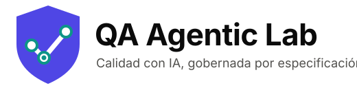
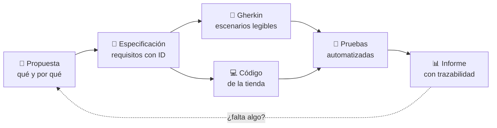
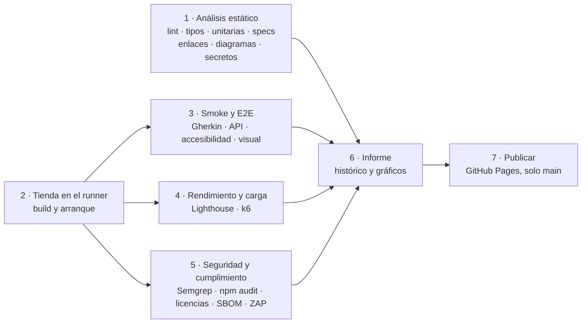
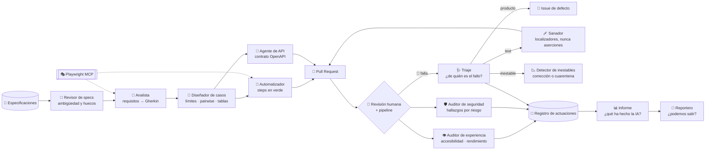
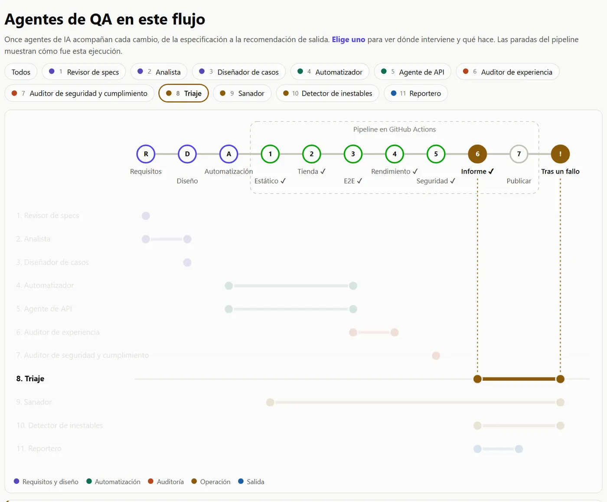

<p align="center">
  
</p>

<p align="center">
  <a href="https://github.com/tonyfht/qa-agentic-lab/actions/workflows/pipeline.yml"></a>
  <a href="https://tonyfht.github.io/qa-agentic-lab/"></a>
</p>

**QA Agentic Lab** es un laboratorio abierto para aprender **otra forma de hacer QA**: ni la tradicional, revisando a
mano al final, ni solo automatizar pruebas. Aquí la calidad se apoya en la IA en todo el ciclo de vida del software
(requisitos, pruebas, seguridad, cumplimiento e informe) y todo nace de una **especificación** que manda sobre el
código y sobre las pruebas.

Para enseñarlo hay una tienda online pequeña, **La Tienda en Casa**, construida a propósito para ser probada. Cada
cambio pasa por el mismo camino: especificación → código → escenarios en lenguaje natural (Gherkin) → pruebas →
informe. Puedes recorrerlo con la guía de abajo o ejecutarlo tú mismo.

> **Estado:** laboratorio completo. Los once cambios de la [hoja de ruta](openspec/PROJECT.md#hoja-de-ruta) están
> hechos: una tienda online con fotos y compra de principio a fin, seis etapas de calidad, once agentes de IA con sus límites y un
> informe que termina en una recomendación de salida.

## Ruta de la visita

Sigue los pasos en orden. Cada uno dice qué abrir y qué deberías ver.

1. **La idea en un minuto.** Abre [`openspec/PROJECT.md`](openspec/PROJECT.md). Verás la visión, los cinco requisitos
   que cumple todo el laboratorio y qué agente de IA actúa en cada fase del ciclo.
2. **Las reglas del juego.** Abre [`AGENTS.md`](AGENTS.md). Verás los principios que siguen personas y agentes, por
   ejemplo que *la IA propone, pero las pruebas y las personas deciden*.
3. **Una especificación.** Abre la [spec del catálogo](openspec/specs/catalog/spec.md).
   Verás requisitos con un identificador (`CAT-001`, `CAT-004`...) y escenarios *dado / cuando / entonces*,
   incluido qué pasa cuando algo falla (por ejemplo, un rango de precio invertido).
4. **De la especificación al escenario.** Abre [`filtros.feature`](tests/features/catalog/filtros.feature). Verás
   `CAT-004` convertido en escenarios Gherkin legibles por cualquiera, con una tabla de **valores límite**
   (19,90 € exactos, un céntimo por encima y por debajo) y la etiqueta `@CAT-004` que los une a su requisito.
5. **Los agentes de IA.** Abre [`qa-disenador.md`](.claude/agents/qa-disenador.md) y después
   [`combinaciones.feature`](tests/features/catalog/combinaciones.feature). Verás qué puede y qué **no puede** hacer
   un agente, y su trabajo real: 9 combinaciones *pairwise* de filtros en lugar de 54. La
   [revisión de la spec del catálogo](qa/agents/reviews/catalog.md) es obra del Revisor de specs. Para conocer a
   los once, lee [Conoce a los agentes](#conoce-a-los-agentes) o abre
   [Agentes de QA en este flujo](https://tonyfht.github.io/qa-agentic-lab/agentes.html) y elige uno: verás en qué
   paradas del ciclo interviene.
6. **La tienda.** Ejecuta `npm run dev` (ver [Ejecútalo tú](#ejecútalo-tú)) y abre <http://localhost:3400>.
   Verás una tienda online de verdad, con fotos, categorías y ofertas. Busca "algodón" desde la cabecera (encuentra
   artículos escritos sin tilde) y en el catálogo prueba los filtros: se aplican al momento, cada uno queda como un
   chip que se quita con un clic, y en el móvil van en un cajón. Las fotos son de Unsplash y cada una tiene su
   [crédito](http://localhost:3400/creditos).

   

7. **La API y su contrato.** Con la tienda abierta, mira <http://localhost:3400/api/openapi.json> y
   <http://localhost:3400/api/products?minPrice=19,90&maxPrice=19,90>. Verás el contrato publicado y la misma
   búsqueda que en la web; cada escenario de API comprueba que la respuesta cumple ese contrato.
8. **El carrito y la tabla de decisión.** Abre
   [`cupones-y-totales.feature`](tests/features/cart/cupones-y-totales.feature). Verás una **tabla de decisión**:
   cada fila es una regla de cupón (no existe, caducado, no aplicable, sin mínimo) con el mensaje exacto que ve el
   cliente. Después añade algo al carrito en <http://localhost:3400> y prueba el cupón `VERANO2026` o `BIENVENIDA10`.
9. **La compra completa y la seguridad.** Entra con `cliente@ejemplo.test` / `Casa2026`, tramita el pedido y paga
   con las [tarjetas de prueba](#tarjetas-de-prueba). Luego abre [`pedidos.feature`](tests/features/orders/pedidos.feature).
   Verás un escenario en el que un cliente intenta abrir el pedido de otro: la tienda responde exactamente igual que
   si no existiera, para no revelar nada.
10. **Más allá de lo funcional.** Abre [`accesibilidad.feature`](tests/features/experience/accesibilidad.feature) y
   la [auditoría de experiencia](qa/agents/reviews/experiencia-2026-10-21.md). Verás que una barrera de
   accesibilidad, una página lenta o una prueba de carga con errores paran el pipeline igual que un fallo funcional, y
   cómo el Auditor de experiencia encontró que faltaba el icono de la tienda (y se corrigió). Su
   [antes y después del rediseño](qa/agents/reviews/experiencia-rediseno-2026-10-21.md) enseña lo contrario: un
   cambio grande de la tienda, con fotos, que mantiene Lighthouse en 100.
11. **Seguridad y cumplimiento.** Abre [`compliance/`](compliance/) y la página <http://localhost:3400/privacidad>.
   Verás que cuatro escáneres (Semgrep, `npm audit`, licencias y OWASP ZAP) corren en cada ejecución, que cada
   excepción está escrita con su motivo en lugar de "apagar" una regla, y que el SBOM de cada ejecución queda como
   evidencia en el artefacto **evidencias-seguridad** de GitHub Actions. Después lee la
   [primera auditoría de seguridad](qa/agents/reviews/seguridad-2026-10-21.md): un agente ordena los hallazgos por
   riesgo real, y el más grave (contraseñas que podían acabar en la URL) lo había marcado la herramienta como
   simplemente informativo.
12. **Rompe la tienda a propósito.** Ejecuta `npm run qa -- --stage e2e --inject cupon` (o `selector`, o `caida`) y
   después `npm run qa -- --stage report` y `npm run report`. Verás el pipeline en rojo y, en el informe, un aviso de
   demostración y la sección *¿Qué han reparado los agentes?*: el triaje dice de quién es cada fallo antes de que
   nadie abra un log (`cupon` es del producto, `selector` del test y `caida` del entorno). Luego lee lo que hizo el
   [Sanador](qa/agents/reviews/sanador-2026-10-21.md) con el fallo de `selector`: reparó el localizador, y la
   guardia le impidió "curarlo" relajando la aserción.
13. **El pipeline en GitHub.** Abre la
   [pestaña Actions](https://github.com/tonyfht/qa-agentic-lab/actions/workflows/pipeline.yml) y entra en la última
   ejecución. Verás las etapas por separado y, al final, un resumen con la recomendación de salida, una fila por
   etapa y, si algo ha fallado, el triaje de cada fallo.
14. **El informe de calidad.** Abre el [informe publicado](https://tonyfht.github.io/qa-agentic-lab/). Verás cada
   sección respondiendo a una pregunta:
   - ¿estamos mejor que antes?, ¿dónde se va el tiempo?, ¿dónde están los huecos?;
   - ¿es usable y rápida?, ¿es segura y cumple?;
   - ¿es estable la suite?, ¿qué han reparado los agentes?, ¿qué ha hecho la IA?

   En la trazabilidad, cada requisito aparece con sus pruebas por tipo: por ejemplo, `CAT-004` cubierto a la vez
   por pruebas de interfaz, de API y unitarias. Arriba, el botón **Agentes de QA en este flujo** abre la página de
   los agentes.
15. **¿Podemos salir?** Vuelve al principio del [informe publicado](https://tonyfht.github.io/qa-agentic-lab/). Verás
   la recomendación de salida (*sí*, *con reservas* o *no*) con sus motivos y la comparación con la ejecución
   anterior. La calcula una [regla que se puede leer](report/verdict.ts), no la IA. El
   [Reportero](qa/agents/reviews/reportero-2026-10-21.md) la cuenta en lenguaje de negocio y puede discrepar, pero
   no cambiarla. Y la decisión de salir sigue siendo de una persona.
16. **El gobierno.** Abre la [plantilla de Pull Request](.github/pull_request_template.md). Verás que todo cambio dice
   qué especificación implementa; si no lo dice, el pipeline lo para.

## Cómo funciona

**El ciclo de cada cambio.** Nada se programa sin una especificación aprobada, y de ella salen el código y las pruebas.



**El pipeline.** Las mismas etapas se ejecutan en tu ordenador (`npm run qa`) y en GitHub Actions.



Además, cada Pull Request pasa el **gobierno**: dice qué cambio de OpenSpec implementa, y si lo abre el Sanador, una
guardia comprueba que no ha tocado ninguna aserción. Una ejecución con un defecto inyectado para la demostración
nunca se publica.

**Los agentes de QA.** Cada agente es un fichero versionado en [`.claude/agents/`](.claude/agents/) con su función,
sus herramientas y lo que tiene prohibido. Los agentes proponen; las comprobaciones deterministas y una persona
deciden.



Se ejecutan desde una sesión de [Claude Code](https://claude.com/claude-code) en el repositorio (por ejemplo, *"usa el
subagente qa-disenador sobre el catálogo"*) o desde GitHub con el workflow
[Agentes de QA](.github/workflows/agents.yml). En GitHub necesitan la clave `ANTHROPIC_API_KEY` en los
*secrets*; sin ella, el workflow se omite avisando. Se apoyan en los
[Playwright Test Agents](https://playwright.dev/docs/test-agents) y en su servidor MCP ([`.mcp.json`](.mcp.json)).

## Conoce a los agentes

Once agentes de IA acompañan cada cambio, de la especificación a la recomendación de salida. Cada uno tiene un
trabajo concreto y algo que **no puede hacer**: así la IA ayuda en todo el ciclo sin decidir por nadie. Para verlos
sobre el flujo, con lo que hicieron en la última ejecución, abre
[**Agentes de QA en este flujo**](https://tonyfht.github.io/qa-agentic-lab/agentes.html) en el informe.

<a href="https://tonyfht.github.io/qa-agentic-lab/agentes.html"></a>

*En la página puedes elegir cada agente: se resaltan sus paradas y aparece su ficha. Aquí, el Triaje.*

**Requisitos y diseño**

### 🔎 Revisor de specs

El primer lector de cada especificación. Antes de diseñar una sola prueba, busca lo que no se entiende, lo que falta
y lo que no se puede comprobar ("rápido", "cómodo"...).
- **Interviene en:** requisitos.
- **No puede:** cambiar las specs; propone y una persona decide.
- **Su trabajo:** la [revisión de la spec del catálogo](qa/agents/reviews/catalog.md) ·
  [definición](.claude/agents/qa-revisor-specs.md).

### 🧭 Analista

Traduce los requisitos a escenarios Gherkin (*dado, cuando, entonces*) que entiende cualquiera, con su riesgo y su
prioridad.
- **Interviene en:** requisitos y diseño.
- **No puede:** inventar comportamiento que la spec no pide.
- **Su trabajo:** [los filtros del catálogo](tests/features/catalog/filtros.feature) ·
  [definición](.claude/agents/qa-analista.md).

### 🧮 Diseñador de casos

Aplica técnicas de diseño de pruebas para probar más con menos casos: valores límite, tablas de decisión y
*pairwise*.
- **Interviene en:** diseño.
- **No puede:** añadir casos sin declarar la técnica que los justifica.
- **Su trabajo:** [9 combinaciones *pairwise* en lugar de 54](tests/features/catalog/combinaciones.feature) ·
  [definición](.claude/agents/qa-disenador.md).

**Automatización**

### 🤖 Automatizador

Escribe el código de Playwright que ejecuta cada escenario contra la tienda de verdad.
- **Interviene en:** automatización y E2E.
- **No puede:** entregar tests en rojo ni tapar la inestabilidad con esperas fijas.
- **Su trabajo:** [los steps del carrito](tests/steps/cart.steps.ts) · [definición](.claude/agents/qa-automatizador.md).

### 🔌 Agente de API

Prueba la API contra su contrato OpenAPI. Un barrido comprueba que todas las lecturas públicas cumplen lo que el
contrato promete.
- **Interviene en:** automatización y E2E.
- **No puede:** cambiar el contrato para que una respuesta lo cumpla.
- **Su trabajo:** [el barrido de contrato](tests/support/contract-sweep.ts) · [definición](.claude/agents/qa-api.md).

**Auditoría**

### 👁️ Auditor de experiencia

Traduce los números de accesibilidad, Lighthouse, regresión visual y carga a lo que notaría un cliente.
- **Interviene en:** E2E y rendimiento.
- **No puede:** relajar presupuestos, umbrales ni referencias visuales.
- **Su trabajo:** [el antes y después del rediseño](qa/agents/reviews/experiencia-rediseno-2026-10-21.md) ·
  [definición](.claude/agents/qa-auditor-experiencia.md).

### 🛡️ Auditor de seguridad y cumplimiento

Ordena los hallazgos de cuatro escáneres por riesgo real y revisa que cada excepción siga justificada. Encontró que
las contraseñas podían acabar en la URL, algo que la herramienta solo marcaba como informativo.
- **Interviene en:** seguridad.
- **No puede:** aceptar excepciones ni rebajar la gravedad por su cuenta.
- **Su trabajo:** [la primera auditoría de seguridad](qa/agents/reviews/seguridad-2026-10-21.md) ·
  [definición](.claude/agents/qa-auditor-seguridad.md).

**Operación**

### 🩺 Triaje

Cuando la suite se pone en rojo, responde primero a la pregunta que importa: ¿de quién es el fallo? Puede ser del
producto, del test, del entorno o inestabilidad.
- **Interviene en:** el informe y tras un fallo.
- **No puede:** cambiar tests ni código; decide de quién es el fallo, no lo arregla.
- **Su trabajo:** [el triaje de tres defectos inyectados](qa/agents/reviews/triaje-2026-10-21.md) ·
  [definición](.claude/agents/qa-triaje.md).

### 🩹 Sanador

Repara los tests que se rompen por cambios que no son funcionales, como un identificador que ha cambiado. Una
guardia automática bloquea su PR si toca una aserción.
- **Interviene en:** tras un fallo; su arreglo vuelve a pasar el análisis estático.
- **No puede:** tocar una aserción, un escenario ni la tienda.
- **Su trabajo:** [la reparación de un localizador](qa/agents/reviews/sanador-2026-10-21.md) ·
  [definición](.claude/agents/qa-sanador.md).

### 📉 Detector de inestables

Mide con el histórico qué tests solo pasan al reintentar y distingue si el problema es del test o de la máquina.
- **Interviene en:** el informe y tras un fallo.
- **No puede:** poner tests en cuarentena por su cuenta ni subir reintentos para tapar.
- **Su trabajo:** [el análisis de estabilidad](qa/agents/reviews/estabilidad-2026-10-21.md) ·
  [definición](.claude/agents/qa-detector-flaky.md).

**Salida**

### 📣 Reportero

Cuenta en lenguaje de negocio la recomendación de salida (*¿podemos salir?*) y qué ha cambiado frente al histórico.
La recomendación la calcula una regla; él la explica.
- **Interviene en:** el informe y la publicación.
- **No puede:** cambiar la recomendación ni suavizar un motivo de bloqueo.
- **Su trabajo:** [el resumen ejecutivo](qa/agents/reviews/reportero-2026-10-21.md) ·
  [definición](.claude/agents/qa-reportero.md).

## Ejecútalo tú

**Requisitos previos:** [Node.js 24](https://nodejs.org) y Git. Opcionales: [Gitleaks](https://github.com/gitleaks/gitleaks), [k6](https://grafana.com/docs/k6/latest/set-up/install-k6/), [Semgrep](https://semgrep.dev/docs/getting-started/) (Linux o macOS) y Docker (para OWASP ZAP)
para secretos, carga, SAST y DAST: sin ellos, esas comprobaciones constan como omitidas con el motivo, nunca como superadas. En GitHub Actions corren todas.

```bash
git clone https://github.com/tonyfht/qa-agentic-lab.git
cd qa-agentic-lab
npm ci
npx playwright install chromium
```

| Quiero... | Comando | Dónde lo veo |
|---|---|---|
| Abrir la tienda | `npm run dev` | <http://localhost:3400> |
| Ver el contrato de la API | `npm run dev` | <http://localhost:3400/api/openapi.json> |
| Probar el carrito y los cupones | `npm run dev` | <http://localhost:3400/carrito> (cupones: `BIENVENIDA10`, `CASA5`, `TEXTIL15`, `ENVIOGRATIS`, `VERANO2026`) |
| Ejecutar todo el pipeline | `npm run qa` | Resumen en la consola |
| Ejecutar una sola etapa | `npm run qa -- --stage e2e` | Etapas: `static`, `build`, `e2e`, `performance`, `security`, `report` |
| Romper la tienda a propósito | `npm run qa -- --stage e2e --inject cupon` | Defectos: `cupon` (producto), `selector` (test), `caida` (entorno). Triaje en `reports/runs/<id>/triaje.md` tras `--stage report` |
| Medir rendimiento y carga | `npm run qa -- --stage performance` | Lighthouse en 3 páginas y k6 con 20 usuarios (si está instalado) |
| Ver el informe con mi histórico | `npm run report` | <http://localhost:3420> |
| Ver los agentes sobre el flujo | `npm run report` | <http://localhost:3420/agentes.html> |

**En GitHub, sin instalar nada:** entra en la
[pestaña Actions](https://github.com/tonyfht/qa-agentic-lab/actions/workflows/pipeline.yml), pulsa **Run workflow** y
elige la rama. El pipeline no necesita ningún secreto. En el mismo formulario puedes elegir un **defecto** para la
demostración: la ejecución se pondrá en rojo, el resumen mostrará el triaje y no se publicará en el histórico.

### Tarjetas de prueba

El pago es **simulado**: no se cobra nada ni se guarda el número de tarjeta (solo los 4 últimos dígitos). Usa
cualquier caducidad futura (por ejemplo `12/30`) y un CVC de 3 dígitos.

| Tarjeta | Resultado |
|---|---|
| `4242 4242 4242 4242` | Aprobada |
| `4000 0000 0000 0002` | Rechazada por el banco |
| `4000 0000 0000 9995` | Fondos insuficientes |
| `4242 4242 4242 4241` | Número no válido (no pasa el algoritmo de Luhn) |
| Cualquiera con caducidad pasada | Tarjeta caducada |

Cuenta de demostración: `cliente@ejemplo.test` / `Casa2026` (ficticia; también puedes registrarte con datos
inventados).

## Qué hay en el repositorio

| Carpeta | Qué contiene |
|---|---|
| [`openspec/`](openspec/) | Especificaciones y cambios: la fuente de verdad |
| [`app/`](app/), [`lib/`](lib/) | La Tienda en Casa (Next.js) y su API |
| [`public/images/`](public/images/) | Las fotos de la tienda y sus créditos ([`creditos.json`](public/images/creditos.json)) |
| [`tests/`](tests/) | Escenarios Gherkin, pasos, pruebas unitarias, el reporter de resultados y las referencias visuales |
| [`.claude/agents/`](.claude/agents/) | La definición de cada agente de QA: función, herramientas y lo que tiene prohibido |
| [`qa/`](qa/) | El orquestador del pipeline (`npm run qa`), el formato de resultados, el registro y las revisiones de los agentes, el triaje, la estabilidad, la cuarentena y la guardia del Sanador |
| [`compliance/`](compliance/) | La política de licencias y las excepciones de seguridad aceptadas, cada una con su motivo |
| [`report/`](report/) | El generador del informe de calidad, la recomendación de salida y la página de agentes |
| [`schemas/`](schemas/) | El formato publicado del resultado de cada ejecución (JSON Schema) |
| [`.github/`](.github/) | Workflows, plantillas de PR e *issues* y Dependabot |

## Sobre el autor

<table>
<tr>
<td width="120" valign="top">
  <a href="https://antonioherrera.tech"></a>
</td>
<td valign="top">

**Antonio Herrera** · Fractional CTO y asesor tecnológico.<br>
Construyo laboratorios abiertos para aprender a hacer QA con IA y gobernada por especificación, y los pruebo de verdad
antes de publicarlos.

[](https://antonioherrera.tech)
[](https://antonioherrera.tech/guias/)
[](https://www.linkedin.com/in/antoniofranciscoherrera/)
[](https://www.linkedin.com/newsletters/6984444085109469184/)
[](https://github.com/tonyfht)

</td>
</tr>
</table>

¿Te ha servido? Dale una ⭐ al repositorio, compártelo o cuéntamelo en
[LinkedIn](https://www.linkedin.com/in/antoniofranciscoherrera/). Si encuentras un error o un paso de la ruta que ya
no funciona, abre un [issue](https://github.com/tonyfht/qa-agentic-lab/issues).

## Licencia

[MIT](LICENSE). Proyecto formativo y sin ánimo de lucro.
